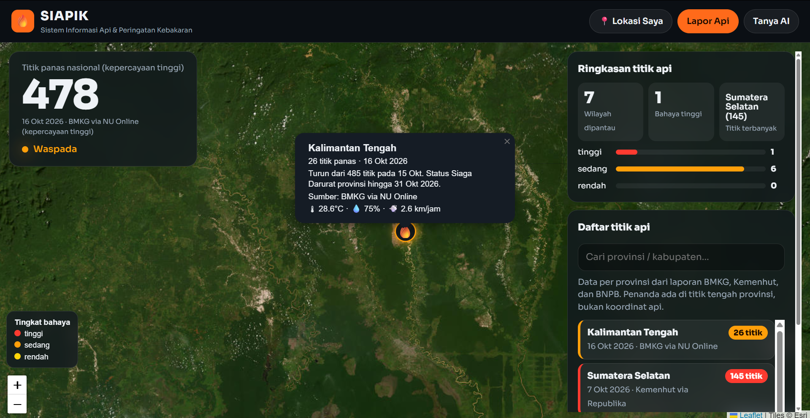

# 🔥 SIAPIK — Sistem Informasi Api & Peringatan Kebakaran

<p align="center">
  
</p>

<p align="center">
  <b>Peta interaktif titik api kebakaran hutan &amp; lahan Indonesia — lengkap dengan cuaca, laporan warga, statistik, dan asisten AI.</b><br>
  Web statis (HTML/CSS/JS) tanpa backend, bisa di-install sebagai PWA.
</p>

<p align="center">
  
  
  
  
  
  
  
</p>

---

## ✨ Fitur

| | Fitur | Keterangan |
|---|---|---|
| 🗺️ | **Peta interaktif** | Leaflet + basemap satelit Esri, marker 🔥 besar berwarna per tingkat bahaya |
| 📋 | **Sidebar daftar titik api** | Badge **BARU / HARI INI / LAMA**, klik item → peta terbang ke lokasi |
| 🌦️ | **Cuaca per titik** | Data **Open-Meteo** (suhu, kelembapan, angin) di popup |
| 📝 | **Laporan warga** | Form laporan tersimpan lokal (`localStorage`) — untuk demo |
| 📊 | **Statistik** | Jumlah titik api, sebaran provinsi, ringkasan tingkat bahaya |
| 🔎 | **Pencarian** & **📍 Lokasi Saya** | Filter titik api + geolocation (dot biru) |
| 🤖 | **Asisten AI** | Chatbot Groq (`llama-3.1-8b-instant`), system prompt kebakaran & kontak darurat |
| 📲 | **PWA** | Bisa di-install, punya Service Worker untuk caching |
| 🌙 | **Tema Nightwatch** | Mode gelap dengan aksen oranye |

> ℹ️ **Asisten AI butuh API Key Groq gratis** (diisi sekali lewat UI, disimpan di `localStorage` browser kamu — **tidak pernah** masuk ke kode).

## 🖼️ Tangkapan Layar

> Tambahkan screenshot kamu di sini agar repo makin keren:
> `docs/screenshot-peta.png`, `docs/screenshot-chat.png`

```md


```

## 🛠️ Teknologi

- **Leaflet** — peta interaktif
- **Esri World Imagery** — basemap satelit (gratis, tanpa API key)
- **Open-Meteo** — data cuaca (gratis, tanpa API key)
- **Groq API** — LLM `llama-3.1-8b-instant` untuk chatbot
- **Vanilla JS** — tanpa framework, tanpa build step
- **Service Worker + Web App Manifest** — PWA

## 📁 Struktur

```
siapik/
├── index.html            # Halaman utama
├── manifest.json         # Manifest PWA
├── sw.js                 # Service Worker (cache offline)
├── css/
│   ├── theme.css         # Variabel warna & tema "Nightwatch"
│   ├── style.css         # Layout & komponen
│   └── chat.css          # Gaya khusus chatbot
├── js/
│   ├── app.js            # Entry point & orkestrasi init()
│   ├── map.js            # Peta Leaflet, marker, legenda
│   ├── data.js           # Memuat data/hotspots.json
│   ├── weather.js        # Cuaca Open-Meteo
│   ├── report.js         # Form laporan warga (localStorage)
│   ├── stats.js          # Statistik titik api
│   └── chatbot.js        # Asisten AI (Groq)
├── data/
│   ├── hotspots.json     # Titik api
│   └── knowledge.json    # Chip pertanyaan cepat chatbot
└── assets/
    └── icons/            # Ikon PWA
```

## 🚀 Cara Menjalankan

Buka website melalui link berikut: https://siapiklatika.netlify.app/

Karena memuat `data/*.json` via `fetch`, **jalankan lewat server lokal** (bukan buka `file://`):

```bash
# Pilih salah satu
python -m http.server 8080
# atau
npx serve
```

Lalu buka 👉 **http://localhost:8080**

> 💡 **Service Worker & geolocation** hanya aktif di `localhost` atau `https://`, **tidak** di `file://`.

### 🤖 Mengaktifkan Chatbot AI

1. Ambil API key gratis di **[console.groq.com/keys](https://console.groq.com/keys)** (`gsk_...`).
2. Buka web → klik **"Tanya AI"** → paste key di kolom.
3. Key tersimpan di browser (tampil "✅ API Key Groq tersimpan") — isi sekali saja.

## 🗺️ Roadmap

- [x] Peta Leaflet + marker berwarna per tingkat bahaya
- [x] Cuaca Open-Meteo per titik
- [x] Form laporan warga (`localStorage`)
- [x] Statistik & pencarian
- [x] PWA (installable + offline cache)
- [x] Chatbot AI (Groq)
- [ ] Sumber hotspot **nyata** (NASA FIRMS / BMKG)
- [ ] Backend proxy agar API key tak terekspos di sisi klien
- [ ] Peringatan berbasis lokasi (notifikasi)

## ⚠️ Disclaimer

Proyek ini dibuat untuk **pembelajaran/demo**. Data titik api bersifat contoh dan laporan warga **tidak** dikirim ke instansi mana pun.

**Dalam keadaan darurat, hubungi:**
- 🚒 Pemadam Kebakaran **113**
- 🆘 Nomor Darurat **112**
- 🛟 Basarnas **115** · BNPB **117**

## 🤝 Kontribusi

Lihat [CONTRIBUTING.md](CONTRIBUTING.md). Issue & PR sangat dialu-alukan.

## 📄 Lisensi

Dirilis di bawah [MIT License](LICENSE).

---

## 👨‍💻 Pengembang

| | | | |
|---|---|---|---|
| **Nama** | Muhammad Arif Nasrullah | **Nama** | Danies Wahyu Hidayat |
| **Kelas** | XI RPL 2 | **Kelas** | XI RPL 1 |
| **Sekolah** | SMK Negeri 2 Singosari | **Sekolah** | SMK Negeri 2 Singosari |
| **Lokasi** | Malang, Jawa Timur, Indonesia 🇮🇩 | **Lokasi** | Malang, Jawa Timur, Indonesia 🇮🇩 |
| **GitHub** | [@nasrulaja](https://github.com/nasrulaja) | **GitHub** | [@danieswahyu27](https://github.com/danieswahyu27) |

<p align="center">Dibuat dengan ❤️ untuk kesiapsiagaan kebakaran Indonesia 🇮🇩</p>


